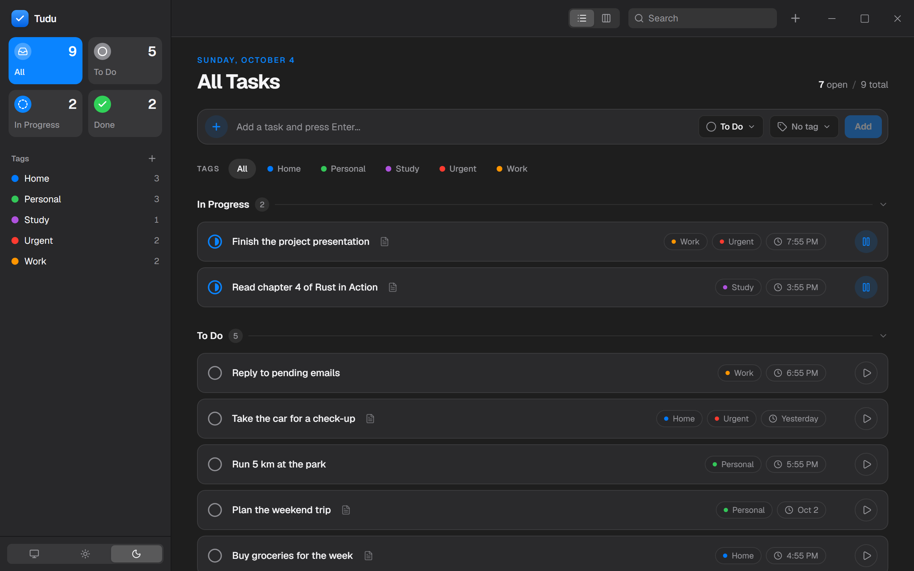
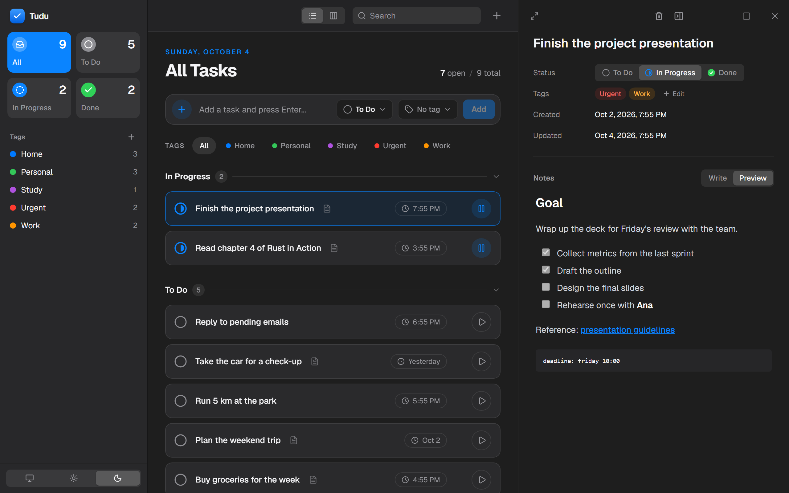
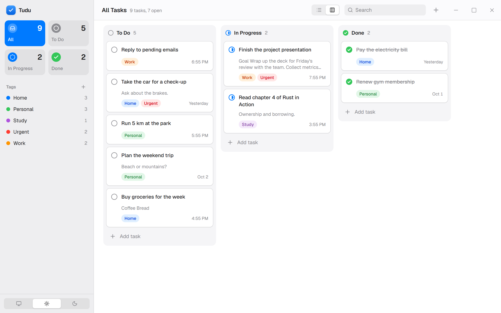

<p align="center">
  
</p>

<h1 align="center">Tudu</h1>

<p align="center">
  Um gerenciador de tarefas pessoal para desktop, feito com Tauri 2, React e Rust.
</p>

## Sobre

Tudu (leia em voz alta) é um app desktop para organizar tudo o que você tem para fazer.
Ele é local: todos os dados ficam em um banco SQLite no seu computador, sem conta e sem precisar de internet.

## Capturas de tela

<p align="center">
  
</p>

<p align="center">
  
</p>

<p align="center">
  
</p>

## Download

Baixe o instalador mais recente na página de [Releases](../../releases) e execute o arquivo `Tudu_x.x.x_x64-setup.exe`.
Não é preciso instalar mais nada.

> Como o app não possui assinatura digital, o Windows pode exibir o aviso "O Windows protegeu o computador".
> Clique em **Mais informações** e depois em **Executar assim mesmo**.

## Funcionalidades

- Criar, editar e excluir tarefas
- Três status: A fazer, Em andamento e Concluído, com registro da data de conclusão
- Visão em lista agrupada por status e quadro Kanban com arrastar e soltar
- Painel de detalhes da tarefa, que também pode ser expandido para tela cheia
- Notas em Markdown com pré-visualização (títulos, links, código, checklists)
- Tags coloridas para agrupar tarefas, com filtro pela barra lateral e por chips na lista
- Ações rápidas para iniciar, pausar ou reabrir uma tarefa
- Busca por título, notas e tags
- Temas claro, escuro e do sistema
- Atalhos de teclado: `Ctrl/Cmd + N` nova tarefa, `Ctrl/Cmd + F` buscar, `Esc` fechar painel

## Tecnologias

| Camada   | Ferramentas                                           |
| -------- | ----------------------------------------------------- |
| Desktop  | Tauri 2                                               |
| Frontend | React 19, TypeScript, Vite, Tailwind CSS 4, shadcn/ui |
| Backend  | Rust, rusqlite (SQLite embutido)                      |
| Outros   | dnd-kit, react-markdown, ícones lucide                |

## Arquitetura

```
src/                  Frontend em React
  components/         Componentes de interface (barra lateral, lista, quadro, painel de detalhes)
  store/              Estado global com atualizações otimistas
  lib/                Tipos, chamadas para o Tauri e utilitários
src-tauri/src/        Backend em Rust
  commands.rs         Comandos do Tauri expostos para o frontend
  db.rs               Acesso ao SQLite, migrações e testes
  models.rs           Tipos de dados compartilhados
```

O frontend se comunica com o Rust por meio de comandos do Tauri (`invoke`). O lado Rust é dono do banco de dados,
executa migrações versionadas ao iniciar (`PRAGMA user_version`) e valida todas as entradas.
O arquivo do banco fica na pasta de dados do aplicativo no sistema, com o nome `tudu.db`.

## Como rodar

### Pré-requisitos

- [Node.js](https://nodejs.org) 20 ou mais recente
- [Rust](https://www.rust-lang.org/tools/install) (versão estável)
- Dependências do Tauri para o seu sistema: [tauri.app/start/prerequisites](https://tauri.app/start/prerequisites/)

### Executar em modo de desenvolvimento

```bash
npm install
npm run tauri dev
```

### Testes

```bash
npm test
```

### Gerar o instalador

```bash
npm run tauri build
```

## Próximos passos

- Várias listas / projetos
- Datas de entrega e lembretes
- Subtarefas
- Exportação e importação
